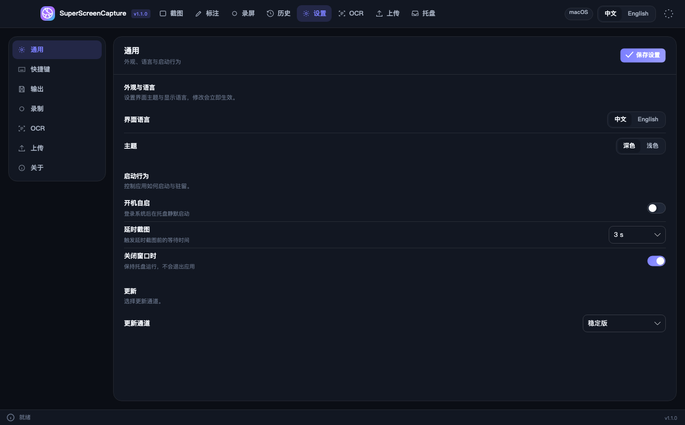
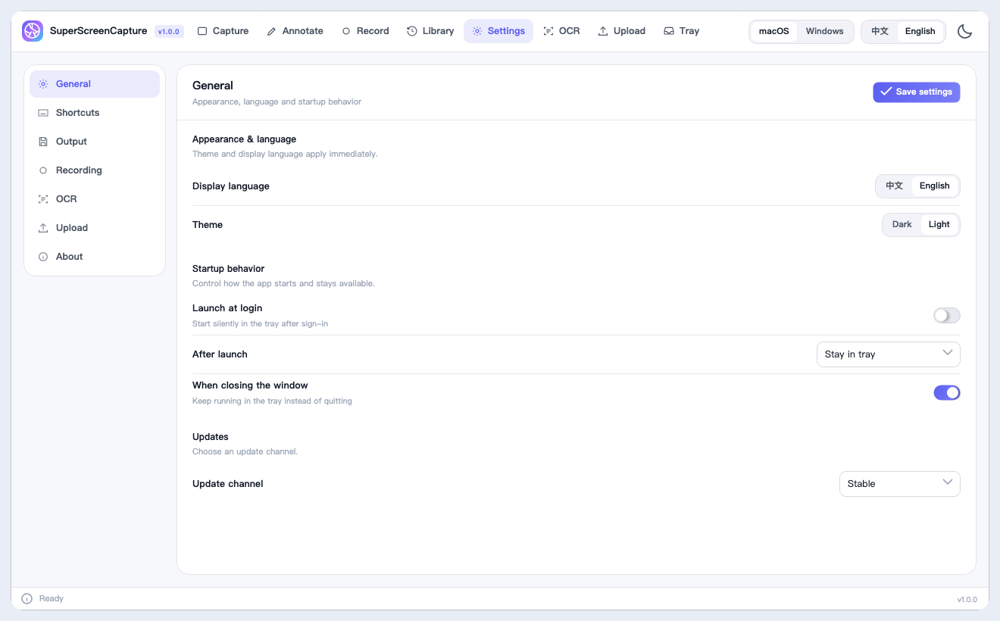
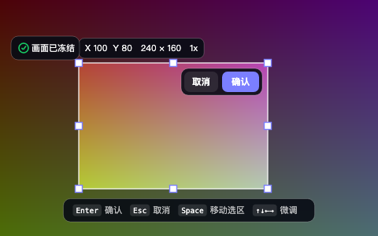
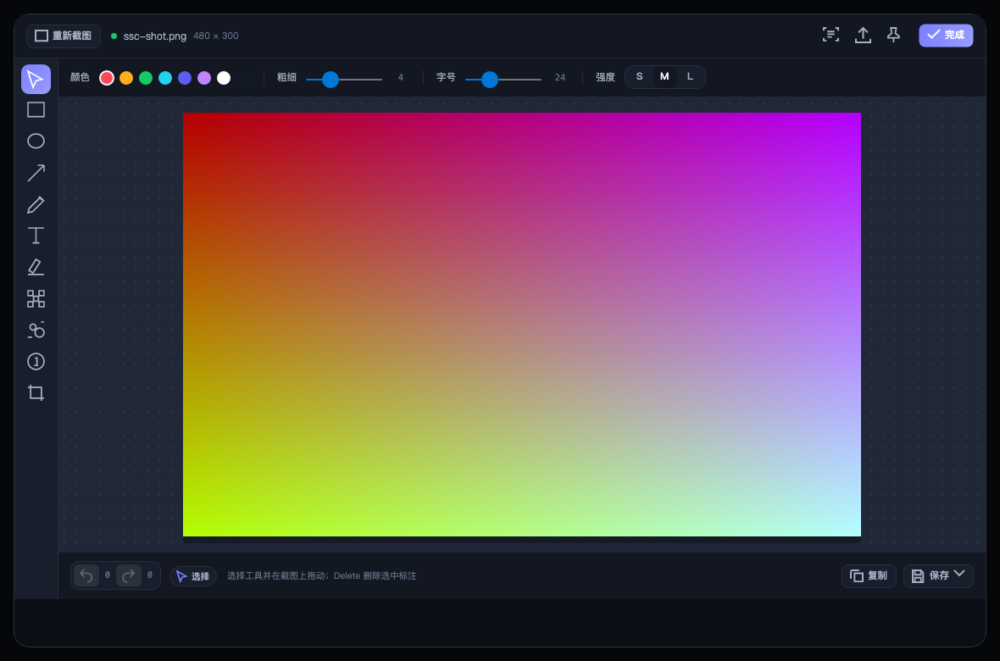
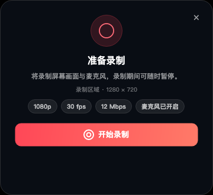
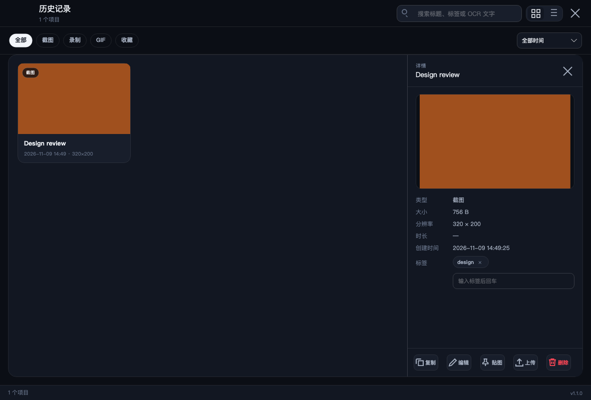
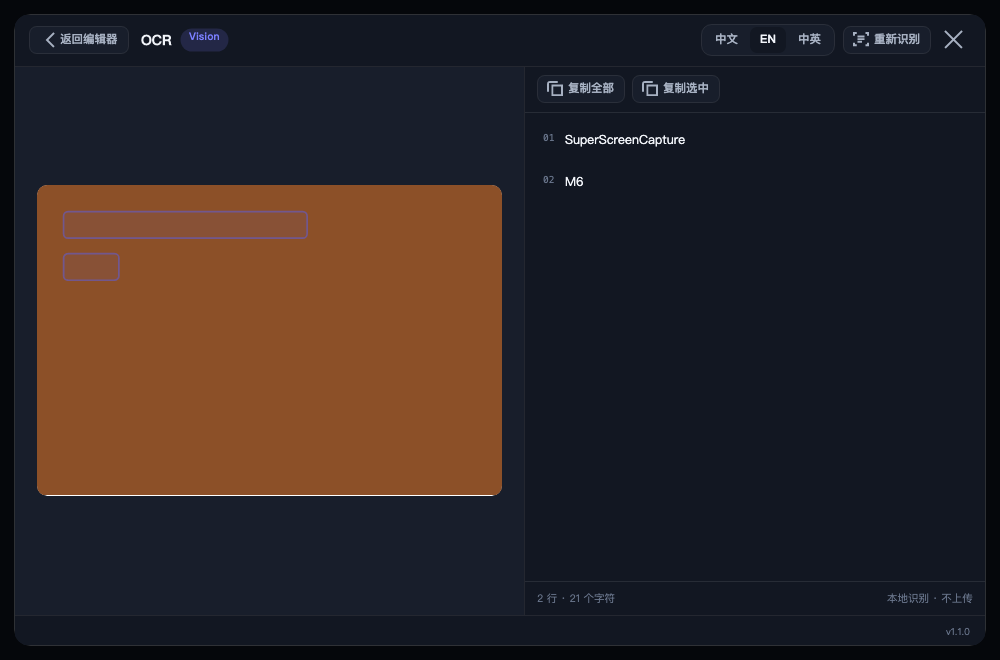
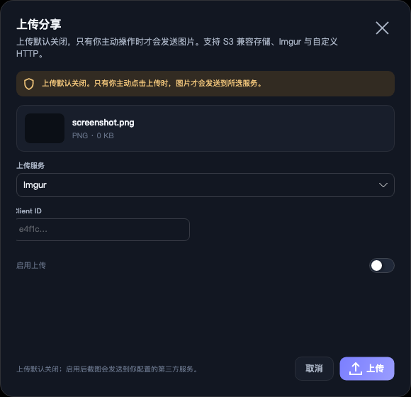

# SuperScreenCapture

English | [简体中文](README.md)

SuperScreenCapture is an Apache-2.0 open-source screenshot and screen recording app for macOS (Apple Silicon / Intel) and Windows (x64 / ARM64). The UI ships in English and Simplified Chinese with light and dark themes.

## Screenshots

| Settings (dark) | Settings (light) |
| --- | --- |
|  |  |
| Region capture | Annotation editor |
|  |  |
| Recording setup | Library |
|  |  |
| OCR | Upload |
|  |  |

## Features

- Capture: full screen, region, window and delayed capture; frozen desktop overlay; multi-monitor and HiDPI; negative-origin virtual desktops; crosshair with live size HUD; magnifier and pixel color picker.
- Annotate: rectangle, ellipse, arrow, pen, text, highlight, mosaic, blur, counter and crop; color, stroke width, font size and strength; undo/redo.
- Output: copy to clipboard; save as PNG, JPG or WebP; pin to screen; quick-access thumbnail with copy/annotate/pin/upload/discard.
- Color picker: full-screen sampling with HEX/RGB/HSL readouts, recent colors and click-to-copy.
- Scrolling capture: manual scroll and frame stitching with safe fallback.
- OCR: macOS Vision and Windows Media OCR; linked overlay/text selection with copy all, copy selection or copy by line.
- Recording: region or full screen, MP4 / H.264 / AAC; microphone mix; pause and resume; camera picture-in-picture (position, size, mirror, corner radius); the control bar stays out of frame.
- GIF: region recording to animated GIF89a with configurable frame rate, duration and size cap.
- History: SQLite + FTS5 full-text search across titles, tags and OCR text; type/time filters; grid and list views; favorites, tag editing, copy, edit, pin, upload and delete.
- Storage: inspect capture/database/cache usage, clean up old items and keep favorites.
- Upload: Imgur, Amazon S3 and custom HTTP; disabled by default; retry, cancel, and copy/open/delete remote links.
- System integration: global hotkeys, tray menu, launch at login, close to tray and single instance.
- Permissions: guided macOS screen recording, microphone and camera consent; no extra prompts on Windows.

## Requirements

| Platform | Version | Architectures |
| --- | --- | --- |
| macOS | 14.0 or later | Apple Silicon (arm64), Intel (x64) |
| Windows | 10 2004 (19041) or later, Windows 11 | x64, ARM64 |

## Install

### macOS

1. Download `SuperScreenCapture-<version>-osx-arm64.dmg` or `osx-x64.dmg`.
2. Open the DMG and drag SuperScreenCapture into Applications.
3. On first launch, grant Screen Recording and reopen the app from System Settings so the permission takes effect. Microphone and camera are requested when those features are used.

Unsigned builds (no release signing secrets configured) are blocked by Gatekeeper:

- Right-click the app in Applications and choose Open, or
- Run `xattr -dr com.apple.quarantine /Applications/SuperScreenCapture.app`.

### Windows

- Installer: run `SuperScreenCapture-win-<arch>-Setup.exe`.
- Portable: extract `SuperScreenCapture-win-<arch>-Portable-<version>.zip` and run `SSC.App.exe`.

Unsigned packages may trigger SmartScreen: choose More info, then Run anyway. Release builds are Authenticode signed when signing secrets are configured.

## First run

The app lives in the tray. Default hotkeys:

| Action | macOS | Windows |
| --- | --- | --- |
| Region capture | ⌘⇧2 | Ctrl+Shift+2 |
| Full-screen capture | ⌥⌘1 | Ctrl+Alt+1 |
| Window capture | ⌥⌘2 | Ctrl+Alt+2 |
| Delayed capture | ⌥⌘3 | Ctrl+Alt+3 |
| Start/stop recording | ⌥⌘4 | Ctrl+Alt+4 |
| Record GIF | ⌥⌘G | Ctrl+Alt+G |
| Color picker | ⌥⌘P | Ctrl+Alt+P |
| History | ⌥⌘H | Ctrl+Alt+H |
| OCR | ⌥⌘O | Ctrl+Alt+O |

macOS reserves ⌘⇧3/4/5/6 for system screenshots, so the defaults use ⌥⌘ chords; legacy defaults migrate automatically on upgrade.

Hotkeys can be recorded and changed in Settings → Hotkeys; conflicts are reported immediately.

## Settings

- Output: save directory, filename pattern, default format (PNG/JPG/WebP) and JPEG quality.
- Recording: frame rate, bitrate, maximum height and microphone toggle.
- OCR: system OCR is preferred; on Windows, Settings → OCR shows a language-pack install guide when needed.
- Upload: off by default. Credentials are stored only in the local settings database.

### Upload providers

- Imgur: provide an Imgur Client ID.
- Amazon S3: provide Access Key, Secret Key, Bucket, Region and an optional public prefix.
- Custom HTTP: provide upload URL, field name, transport (multipart or JSON) and optional headers.

## Data locations

| Content | macOS | Windows |
| --- | --- | --- |
| Settings, database, logs, cache | `~/Library/Application Support/SuperScreenCapture` | `%LOCALAPPDATA%\SuperScreenCapture` |
| Default screenshot folder | `~/Pictures/SuperScreenCapture` | `%USERPROFILE%\Pictures\SuperScreenCapture` |

## Build from source

Requirements:

- .NET 10 SDK (`global.json` pins 10.0.403 with latestFeature roll-forward)
- macOS: Xcode and the Swift toolchain (builds `native/mac/SSCMacKit`)
- Windows: Windows 10 SDK (Media Foundation / WGC projections)

```bash
dotnet restore SuperScreenCapture.slnx
dotnet build SuperScreenCapture.slnx -c Release
dotnet test SuperScreenCapture.slnx -c Release
```

Run and package on macOS:

```bash
dotnet publish src/SSC.App/SSC.App.csproj -c Release -f net10.0 -r osx-arm64 --self-contained true -o artifacts/osx-arm64
./build/mac/create-app-bundle.sh artifacts/osx-arm64 artifacts/SuperScreenCapture.app
./build/mac/create-dmg.sh artifacts/SuperScreenCapture.app artifacts/SuperScreenCapture.dmg
```

Package on Windows:

```powershell
dotnet publish src/SSC.App/SSC.App.csproj -c Release -f net10.0-windows10.0.19041.0 -r win-x64 --self-contained true -o artifacts/win-x64
./build/windows/package-portable.ps1 -PublishDir artifacts/win-x64 -OutputDir artifacts/packages -Rid win-x64 -Version 1.0.0
./build/windows/package-velopack.ps1 -PublishDir artifacts/win-x64 -OutputDir artifacts/packages -Version 1.0.0
```

### Release signing

Signing scripts exit successfully without credentials, so unsigned builds work out of the box. CI uses these secrets:

| Secret | Purpose |
| --- | --- |
| `MACOS_CERT_P12` | Developer ID certificate (base64) |
| `MACOS_CERT_PASSWORD` | Certificate password |
| `MACOS_KEYCHAIN_PASSWORD` | Temporary keychain password (optional) |
| `APPLE_ID` | Notarization Apple ID |
| `APPLE_TEAM_ID` | Notarization team ID |
| `APPLE_APP_SPECIFIC_PASSWORD` | App-specific password |
| `WINDOWS_CERT_PFX` | Authenticode certificate (base64) |
| `WINDOWS_CERT_PASSWORD` | Certificate password |

Push a `v*` tag or run the `release` workflow manually. It builds all four platform packages, writes SHA256SUMS and creates a GitHub Release.

## Architecture

```
SSC.Domain ← SSC.Application ← SSC.Infrastructure
SSC.Application ← SSC.Platform.{Mac,Windows,Mock} ← SSC.App
SSC.Application ← SSC.UI (Avalonia MVVM) ← SSC.App (composition root)
native/mac/SSCMacKit (Swift, C ABI) ← SSC.Platform.Mac
```

- Patterns: Strategy (capture/annotation/OCR/upload/stitching), Command + Memento (undo/redo), Facade (capture and recording orchestration), State (recording state machine), Chain of Responsibility (OCR fallback and upload pipeline), Repository (SQLite) and Observer (app event bus).
- Geometry uses physical pixels; DIPs are UI-only. Multi-monitor negative origins are handled in virtual desktop coordinates.
- The macOS native layer uses ScreenCaptureKit, AVFoundation and Vision. Windows uses WGC/DXGI, Media Foundation and Windows.Media.Ocr.

## Known limitations

- System audio capture is not implemented yet; v1 records screen video plus microphone.
- Window recording on Windows uses WGC; unpackaged apps may show the system capture border. Full-screen recording prefers DXGI Desktop Duplication.
- Windows OCR requires the corresponding language pack.
- Scrolling capture targets manually scrolled, mostly static content. When matching fails the app reports it and keeps the collected frames.
- Unsigned builds require the manual Gatekeeper/SmartScreen steps above.

## License

Apache License 2.0. See [LICENSE](LICENSE) and [NOTICE](NOTICE). Third-party components are listed in `build/third-party-notices.txt` (shipped as `THIRD-PARTY-NOTICES.txt`).
