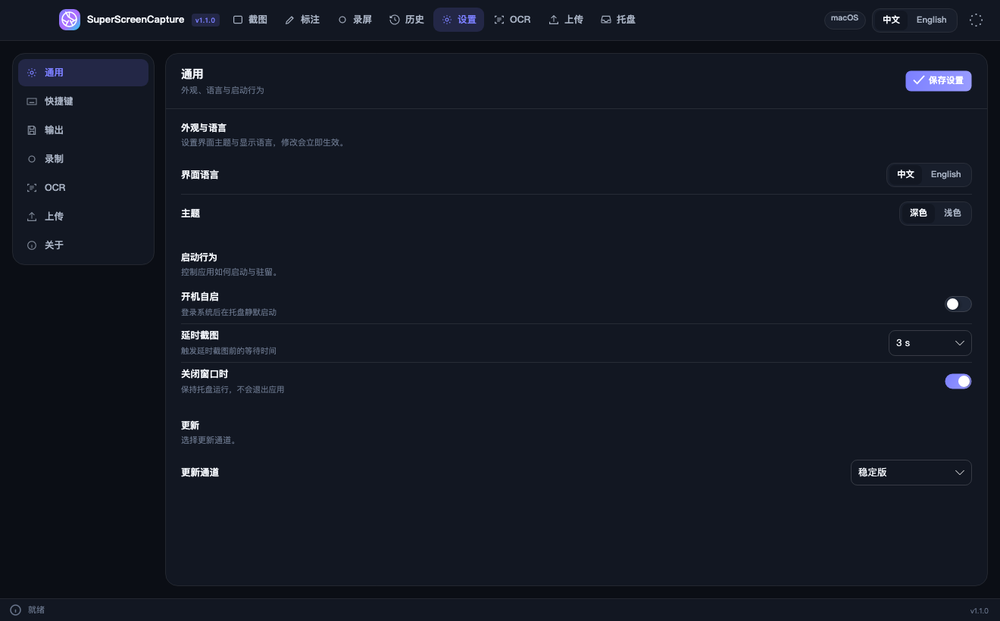
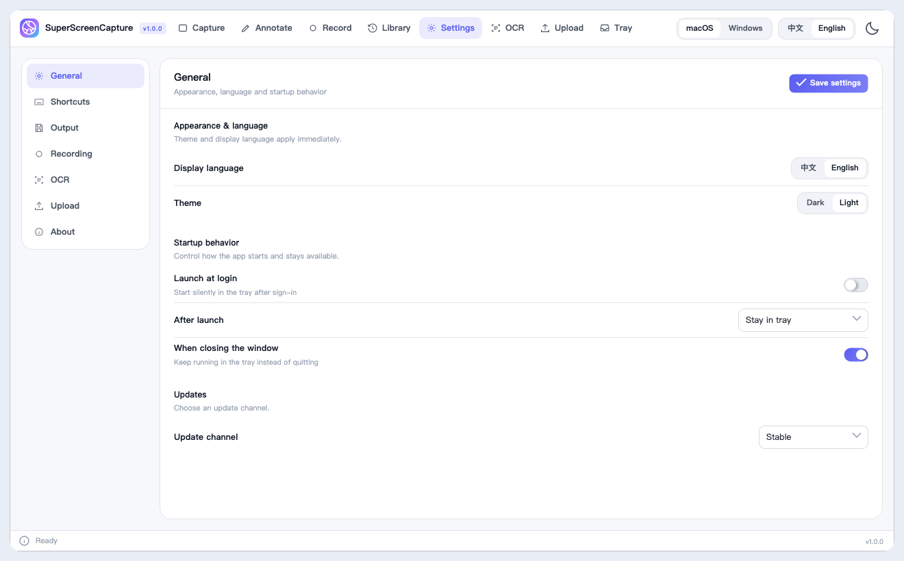
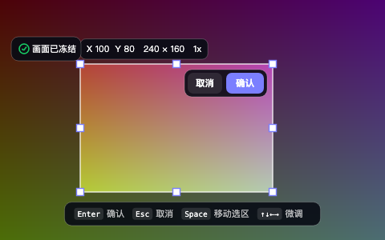
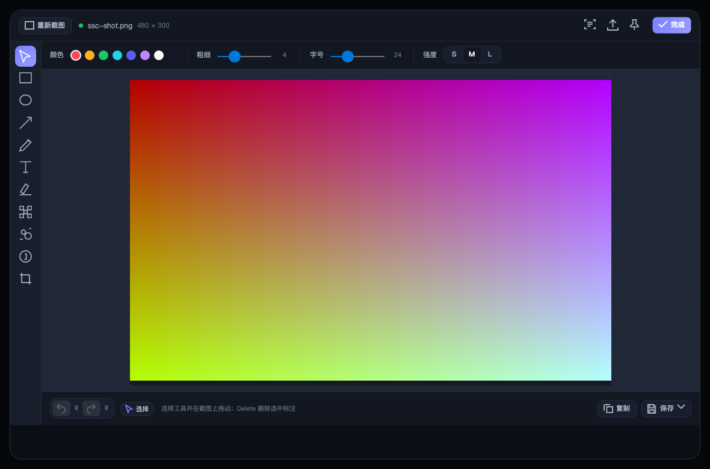
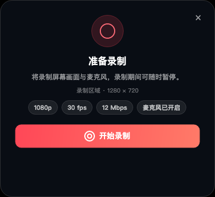
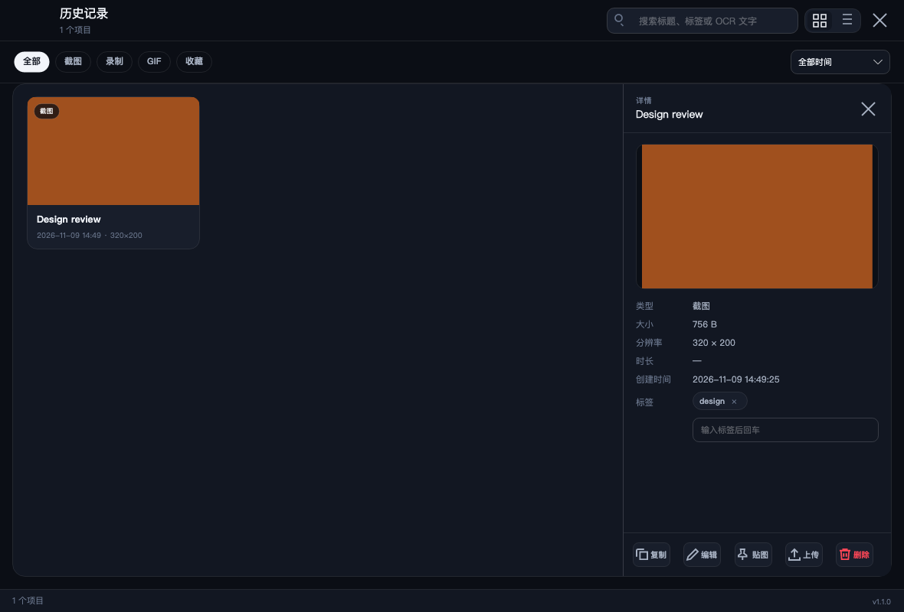
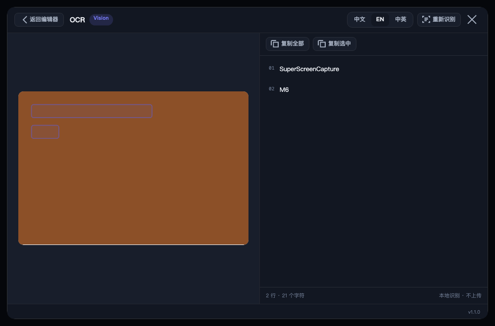
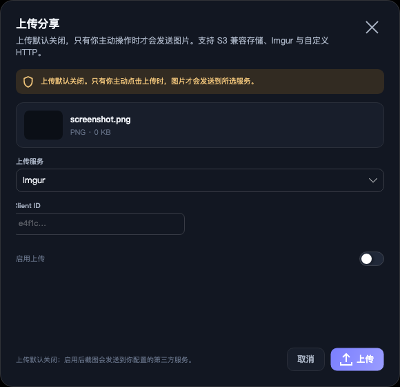

# SuperScreenCapture

[English](README.en.md) | 简体中文

SuperScreenCapture 是一款 Apache-2.0 开源的跨平台截图与录屏工具，面向 macOS（Apple Silicon / Intel）与 Windows（x64 / ARM64）。界面支持简体中文与 English，可跟随系统或手动切换深浅主题。

## 界面预览

| 设置（深色） | 设置（浅色） |
| --- | --- |
|  |  |
| 区域截图 | 标注编辑器 |
|  |  |
| 录屏准备 | 历史记录 |
|  |  |
| 文字识别 | 上传分享 |
|  |  |

## 功能

- 截图：全屏、区域、窗口、延时截图；冻结桌面覆盖层；多屏与 HiDPI；负坐标虚拟桌面；十字准线与实时尺寸 HUD；放大镜与像素取色。
- 标注：矩形、椭圆、箭头、画笔、文字、高亮、马赛克、模糊、序号、裁剪；颜色、线宽、字号、强度；撤销/重做。
- 输出：复制到剪贴板；PNG、JPG、WebP 保存；贴图置顶（Pin）；截图后快速访问浮窗（复制/标注/贴图/上传/丢弃）。
- 取色：全屏取色覆盖层，HEX/RGB/HSL 读数与最近颜色，单击即复制。
- 滚动长截图：手动滚动逐帧拼接，失败时安全降级。
- OCR：macOS Vision、Windows Media OCR；识别框与文本联动，支持复制全部/选中/按行。
- 录屏：区域或全屏，MP4 / H.264 / AAC；麦克风混音；暂停与继续；摄像头画中画（位置、大小、镜像、圆角）；控制条不会被录入。
- GIF：区域录制导出 GIF89a 动图，可设置帧率、时长与尺寸上限。
- 历史库：SQLite + FTS5 全文搜索（标题、标签、OCR 文本）、类型/时间筛选、网格/列表视图、收藏与标签编辑、复制/编辑/贴图/上传/删除。
- 存储管理：查看截图/数据库/缓存占用，按天清理旧条目并可保留收藏。
- 上传分享：Imgur、Amazon S3、自定义 HTTP；默认关闭；失败重试与取消；可用短链复制/打开/删除。
- 系统集成：全局热键、托盘菜单、开机自启、关闭到托盘、单实例。
- 可访问性：macOS 屏幕录制/麦克风/摄像头权限引导；Windows 无额外授权步骤。

## 系统要求

| 平台 | 版本 | 架构 |
| --- | --- | --- |
| macOS | 14.0 及以上 | Apple Silicon (arm64)、Intel (x64) |
| Windows | 10 2004 (19041) 及以上、Windows 11 | x64、ARM64 |

## 安装

### macOS

1. 下载 `SuperScreenCapture-<version>-osx-arm64.dmg` 或 `osx-x64.dmg`。
2. 打开 DMG，将 SuperScreenCapture 拖入“应用程序”。
3. 首次启动后按提示授予“屏幕录制”权限，并在系统设置中重新打开应用使权限生效。录制麦克风或使用摄像头画中画时会分别请求对应权限。

未签名构建（未配置发布签名密钥）会被 Gatekeeper 拦截：

- 在“应用程序”中右键点击应用 →“打开”，或
- 执行 `xattr -dr com.apple.quarantine /Applications/SuperScreenCapture.app`。

### Windows

- 安装版：运行 `SuperScreenCapture-win-<arch>-Setup.exe`。
- 便携版：解压 `SuperScreenCapture-win-<arch>-Portable-<version>.zip` 后运行 `SSC.App.exe`。

未签名的安装包或可执行文件可能触发 SmartScreen：点击“更多信息”→“仍要运行”。正式发布包在配置签名密钥后为 Authenticode 签名。

## 首次使用

启动后应用驻留托盘。默认快捷键：

| 操作 | macOS | Windows |
| --- | --- | --- |
| 区域截图 | ⌘⇧2 | Ctrl+Shift+2 |
| 全屏截图 | ⌥⌘1 | Ctrl+Alt+1 |
| 窗口截图 | ⌥⌘2 | Ctrl+Alt+2 |
| 延时截图 | ⌥⌘3 | Ctrl+Alt+3 |
| 开始/停止录屏 | ⌥⌘4 | Ctrl+Alt+4 |
| 录制 GIF | ⌥⌘G | Ctrl+Alt+G |
| 屏幕取色 | ⌥⌘P | Ctrl+Alt+P |
| 历史库 | ⌥⌘H | Ctrl+Alt+H |
| OCR | ⌥⌘O | Ctrl+Alt+O |

macOS 保留了 ⌘⇧3/4/5/6 给系统截图，因此默认改用 ⌥⌘ 组合；旧版默认值会在升级时自动迁移。

快捷键可在“设置 → 快捷键”中录制与修改，冲突会即时提示。

## 设置说明

- 输出：保存目录、文件名模板、默认格式（PNG/JPG/WebP）、JPG 质量。
- 录制：帧率、码率、最大高度、麦克风开关。
- OCR：优先使用系统 OCR；Windows 缺少语言包时可在“设置 → OCR”查看安装指引。
- 上传：默认关闭。选择 provider 后填写凭据，密钥仅保存在本机设置数据库中。

### 上传 provider

- Imgur：填写 Imgur Client ID。
- Amazon S3：填写 Access Key、Secret Key、Bucket、Region、可选公开前缀。
- 自定义 HTTP：填写上传地址、字段名、请求方式（multipart 或 JSON）与可选请求头。

## 数据位置

| 内容 | macOS | Windows |
| --- | --- | --- |
| 设置、数据库、日志、缓存 | `~/Library/Application Support/SuperScreenCapture` | `%LOCALAPPDATA%\SuperScreenCapture` |
| 默认截图目录 | `~/Pictures/SuperScreenCapture` | `%USERPROFILE%\Pictures\SuperScreenCapture` |

## 从源码构建

依赖：

- .NET 10 SDK（`global.json` 锁定 10.0.403，允许 latestFeature）
- macOS：Xcode 与 Swift 工具链（构建 `native/mac/SSCMacKit`）
- Windows：Windows 10 SDK（Media Foundation / WGC 投影）

```bash
dotnet restore SuperScreenCapture.slnx
dotnet build SuperScreenCapture.slnx -c Release
dotnet test SuperScreenCapture.slnx -c Release
```

macOS 本地运行与打包：

```bash
dotnet publish src/SSC.App/SSC.App.csproj -c Release -f net10.0 -r osx-arm64 --self-contained true -o artifacts/osx-arm64
./build/mac/create-app-bundle.sh artifacts/osx-arm64 artifacts/SuperScreenCapture.app
./build/mac/create-dmg.sh artifacts/SuperScreenCapture.app artifacts/SuperScreenCapture.dmg
```

Windows 打包：

```powershell
dotnet publish src/SSC.App/SSC.App.csproj -c Release -f net10.0-windows10.0.19041.0 -r win-x64 --self-contained true -o artifacts/win-x64
./build/windows/package-portable.ps1 -PublishDir artifacts/win-x64 -OutputDir artifacts/packages -Rid win-x64 -Version 1.1.0
./build/windows/package-velopack.ps1 -PublishDir artifacts/win-x64 -OutputDir artifacts/packages -Version 1.1.0
```

### 发布签名

签名脚本在缺少密钥时自动跳过，未签名产物仍可构建与运行。CI 使用以下 secrets：

| Secret | 用途 |
| --- | --- |
| `MACOS_CERT_P12` | Developer ID 证书（base64） |
| `MACOS_CERT_PASSWORD` | 证书密码 |
| `MACOS_KEYCHAIN_PASSWORD` | 临时 Keychain 密码（可选） |
| `APPLE_ID` | 公证 Apple ID |
| `APPLE_TEAM_ID` | 公证 Team ID |
| `APPLE_APP_SPECIFIC_PASSWORD` | App 专用密码 |
| `WINDOWS_CERT_PFX` | Authenticode 证书（base64） |
| `WINDOWS_CERT_PASSWORD` | 证书密码 |

发布流程：推送 `v*` 标签或手动触发 `release` 工作流。工作流会构建四个平台产物、生成 SHA256SUMS，并创建 GitHub Release。

## 架构

```
SSC.Domain ← SSC.Application ← SSC.Infrastructure
SSC.Application ← SSC.Platform.{Mac,Windows,Mock} ← SSC.App
SSC.Application ← SSC.UI (Avalonia MVVM) ← SSC.App（组合根）
native/mac/SSCMacKit（Swift，C ABI）← SSC.Platform.Mac
```

- 设计模式：Strategy（采集/标注/OCR/上传/拼接）、Command + Memento（撤销重做）、Facade（截图与录制编排）、State（录制状态机）、Chain of Responsibility（OCR 回退与上传管线）、Repository（SQLite）、Observer（应用事件总线）。
- 几何统一使用物理像素，DIP 仅用于 UI；多屏负原点在虚拟桌面坐标系内处理。
- macOS 原生层通过 ScreenCaptureKit、AVFoundation、Vision 实现；Windows 使用 WGC/DXGI、Media Foundation、Windows.Media.Ocr。

## 已知限制

- 系统声音录制尚未实现（v1 仅画面 + 麦克风）。
- Windows 窗口录制使用 WGC，未打包运行时可能显示系统捕获黄框；全屏录制优先使用 DXGI Desktop Duplication。
- Windows OCR 需要系统已安装对应语言包。
- 滚动长截图仅适用于可手动滚动且内容相对静止的页面；匹配失败时会提示并保留多帧结果。
- 未签名构建需要按上文说明手动放行。

## 许可证

Apache License 2.0，见 [LICENSE](LICENSE) 与 [NOTICE](NOTICE)。第三方组件见 `build/third-party-notices.txt`（发布包内为 `THIRD-PARTY-NOTICES.txt`）。
